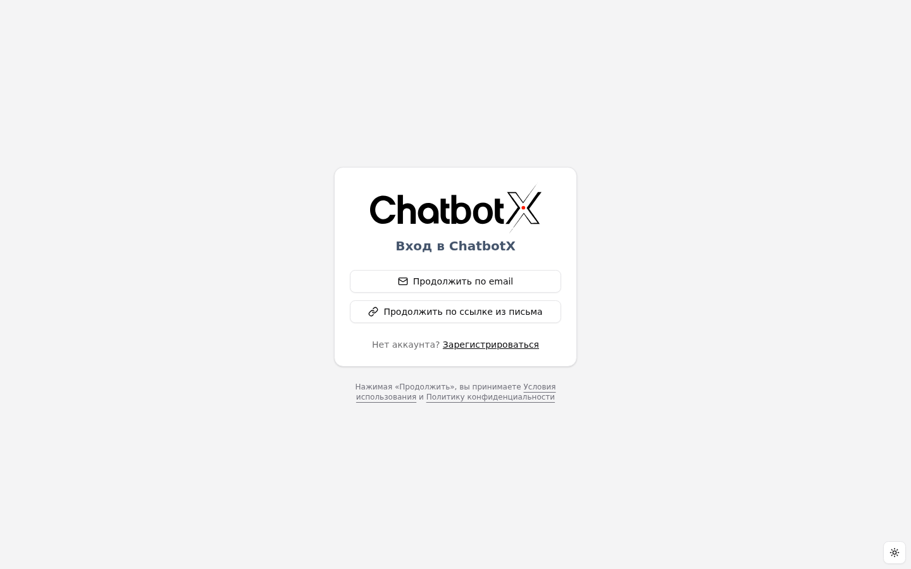
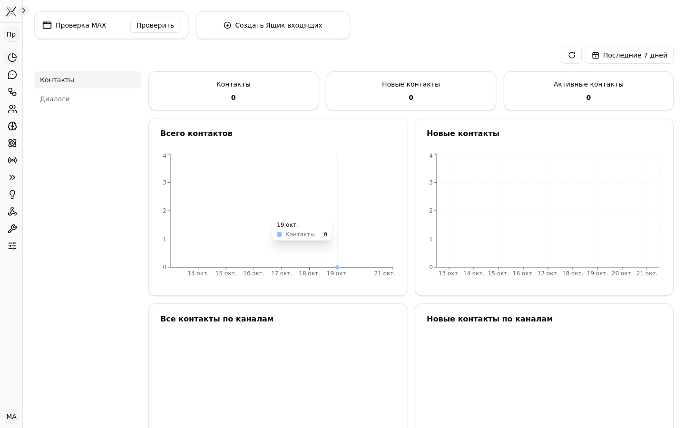
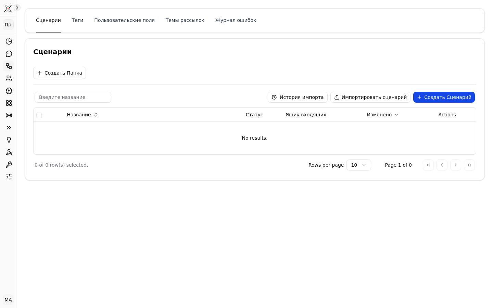
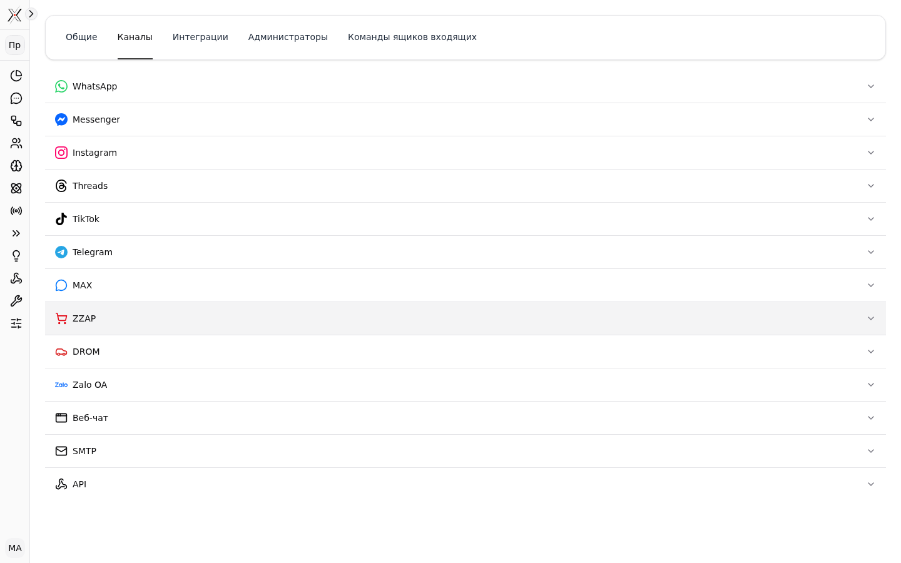

# Russian translation review

Date: 2026-10-21. Plan: `docs/superpowers/plans/2026-10-20-ru-locale.md`. Glossary: `docs/i18n/ru-glossary.md`.

## Coverage

- `apps/builder/messages/ru.json`: 6294 of 6294 strings. 13 batches were translated and merged through `pnpm --filter builder i18n:ru`.
- Strings that stay identical to English: brands, technical labels and examples. There are about 200, listed in `apps/builder/__tests__/fixtures/ru-same-as-english.json`, and the list was reviewed manually. The test "Russian catalog completeness" rejects any other untranslated string and any stale allowlist entry.
- Worker push notifications have a `ru` block. The attachment count is declined: «1 вложение / 2 вложения / 5 вложений».
- The locale is detected from `Accept-Language` when no `NEXT_LOCALE` cookie is set. A saved cookie always wins.

## Automated checks

All checks run on GitHub (`gkamion-checks.yml`); the VPS shares its memory with production.

- `i18n:check`: no missing keys and no invalid translations.
- Builder i18n tests: exact key set, placeholders, ICU structure, and the strict Russian plural categories `one/few/many/other`.
- Worker notification tests.
- `check-types` for the whole monorepo.

## Manual smoke test (production, headless Chromium, `locale: ru-RU`, test manager account)

| Screen | Result |
|---|---|
| Sign in | Russian, `lang=ru` |
| Dashboard | Russian; dates shown as «19 окт.» |
| Inbox | Russian empty states |
| Contacts, Flows, Broadcasts | Russian |
| Settings → Channels | Russian tabs; channel brands unchanged |

## Issues found and fixed

- Templates with an inserted noun produced broken grammar, e.g. «Создать Папка». Russian now uses colon forms («Создать: Папка»).
- «удален(а)» became «Объект «…» будет безвозвратно удален».
- The Follow up status had three different Russian terms. It is unified as «На контроле».
- `messages.sentAttachments`: `i18n-check` requires the `one` branch to match English, which has a literal «1» and no `#`, so Russian uses «1 вложение» in that branch. Counts of 21, 31, … attachments would read «1 вложение». A single message never carries that many attachments.
- The strict ICU test compared nested ICU nodes one occurrence at a time, which rejected correct Russian plurals with extra branches. It now compares per argument.

## Known gap

Some UI text is hardcoded in English in components rather than taken from the catalog. A rough scan found about 160 places. They are mostly the data-table defaults in `packages/ui` («No results.», «Rows per page», «Page 1 of 0», «row(s) selected»), «Actions» column headers, and some placeholders. These strings stay English in every locale until they are moved into the catalog.
